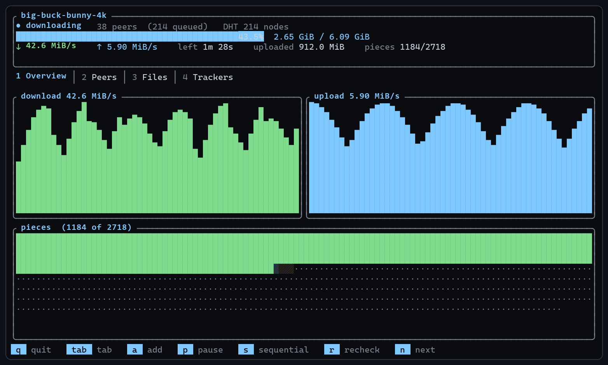
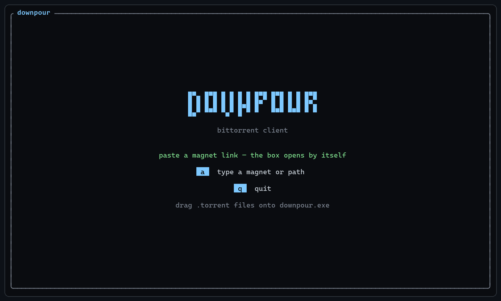
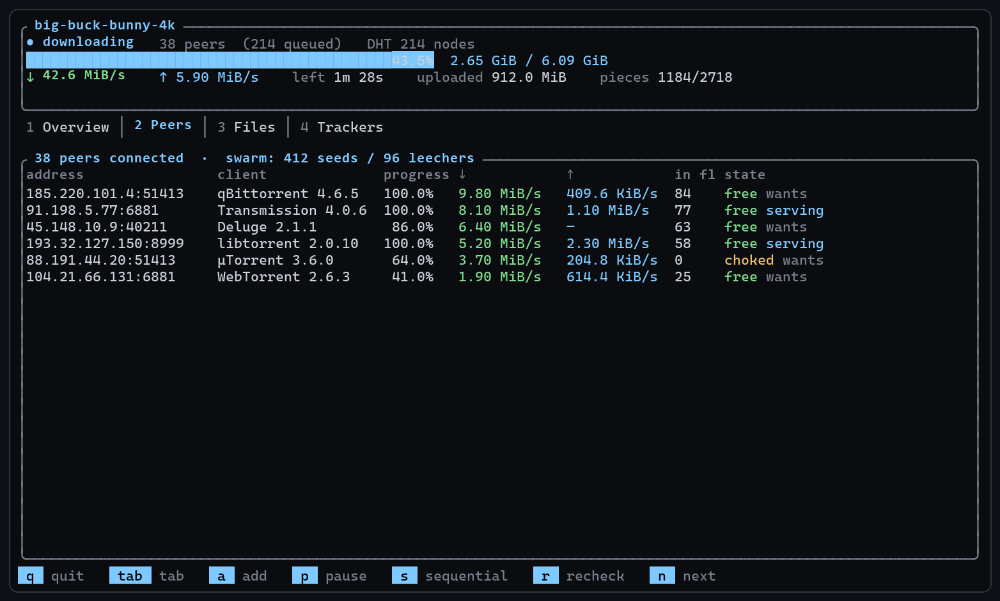
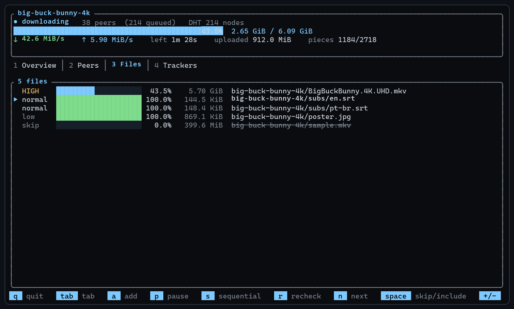
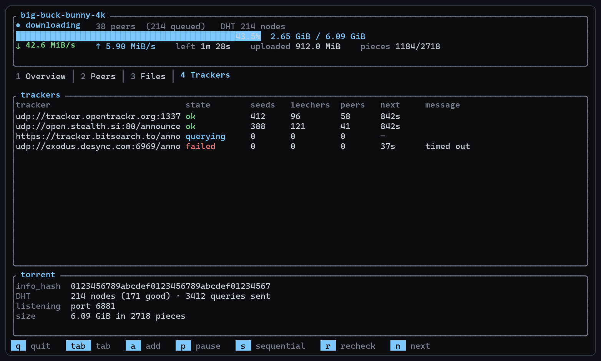
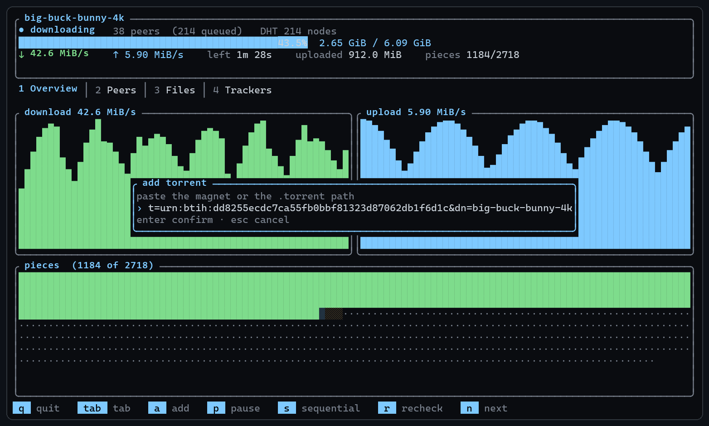

# downpour

[](https://github.com/Dexz00/downpour/actions/workflows/ci.yml)

A terminal BitTorrent client written from scratch in Rust — protocol, DHT,
piece selection and interface, without depending on any torrent library.

It reads `.torrent` files and magnet links.

```
downpour ubuntu.torrent -o ~/Downloads
downpour "magnet:?xt=urn:btih:..." -o ~/Downloads
```

## What is implemented

| Part | Specification |
|---|---|
| Base protocol, bencode, HTTP tracker | BEP-3 |
| Compact tracker peers | BEP-23 |
| DHT (lookup and answering queries) | BEP-5 |
| Fast extension | BEP-6 |
| Extension protocol | BEP-10 |
| Metadata over magnet (`ut_metadata`) | BEP-9 |
| Peer exchange (`ut_pex`), sending and receiving | BEP-11 |
| Multiple trackers in tiers | BEP-12 |
| UDP tracker | BEP-15 |
| `private` flag | BEP-27 |

Beyond that: rarest-first, endgame, sequential selection to watch while
downloading, per-file priority, automatic resume, bandwidth limits, and
SHA-1 verification of every piece before it is written.

## Screenshots



<p>
  
  
</p>
<p>
  
  
</p>



<sub>Screenshots are rendered from the real interface code with sample data;
regenerate them with `cargo test dump_screens_for_screenshots -- --ignored`
followed by `python assets/render-screenshots.py`.</sub>

## Building

```
cargo build --release
```

The binary lands in `target/release/downpour`. On Windows it already comes
with the icon and version block embedded — a single file, with nothing
around it to distribute.

## On Windows: drag and drop

The `downpour.exe` itself is the drop target:

- **drag** one or several `.torrent` files onto it — it downloads all of
  them in the same session;
- **double-click** it — the empty interface opens, where you paste a magnet
  with `Ctrl+V` (the box opens by itself) or with the `a` key.

Opened that way, the destination is your **Downloads** folder — not the
program's directory, which is what Explorer hands us. From a terminal
nothing changes: it stays the current directory.

To pin another destination, create a `destination.txt` next to the `.exe`
with the path on a single line. Precedence order is `-o`, then
`destination.txt`, then Downloads. (The legacy name `destino.txt` is still
honored.)

## Usage

```
downpour <TORRENT|MAGNET>... [options]

  -o, --output <DIR>         destination directory (default: Downloads when
                             opened from a file manager, else the current dir)
  -p, --port <N>             TCP and UDP port (default: 6881)
  -s, --sequential           download in order, to watch while downloading
      --max-peers <N>        connections per torrent (default: 100)
      --slots-upload <N>     peers served at the same time (default: 6)
      --download-limit <R>   e.g. 2M, 500k
      --upload-limit <R>
      --no-dht               trackers only
      --no-seed              exit when done, instead of seeding
      --simple               no interface, one progress line per second
      --info <TORRENT>       show the contents of the file and exit
```

The previous Portuguese flag names (`--saida`, `--porta`, `--sequencial`,
`--sem-dht`, `--sem-seed`, `--simples`, `--limite-download`,
`--limite-upload`) keep working as hidden aliases.

### Interface

| Key | Action |
|---|---|
| `Ctrl+V` | paste a magnet — the box opens by itself |
| `a` | add a torrent (type a magnet or a path) |
| `1`–`4`, `Tab` | switch tabs |
| `↑` `↓` / `j` `k` | move the selection |
| `p` | pause / resume |
| `s` | toggle sequential mode |
| `r` | recheck the files on disk |
| `n` | next torrent |
| `space` | (Files tab) include or skip the file |
| `+` `-` | (Files tab) priority |
| `q` | quit |

### Diagnostics

`DOWNPOUR_LOG` writes details to stderr, filtered by topic:

```
DOWNPOUR_LOG=peer,dht downpour x.torrent 2> log.txt
```

Topics: `peer`, `peers`, `dht`, `state`. `1` enables all of them.

## How it is organized

The implementation lives in a library crate (`src/lib.rs`); the binary is a
thin CLI front end over it.

```
src/lib.rs     library root; the binary only parses the CLI over it
bencode        bencode encoding, preserving the raw `info` bytes
metainfo       .torrent parsing; path sanitization
magnet         magnet links (hex and base32)
id             20-byte identifiers and XOR distance
bitfield       piece bitfield in the protocol layout
compact        compact addresses (tracker, DHT, PEX)
storage        positional I/O mapping pieces onto multiple files
picker         piece and block selection
peer/          wire protocol, extensions, ut_metadata, ut_pex
tracker/       HTTP and UDP announce, tiers, backoff
dht/           KRPC, routing table, iterative lookup
engine/        the loop that decides everything
  mod.rs       decision loop, peer bookkeeping, choking, DHT/PEX timers
  types.rs     Config, Source, State, Command, Snapshot, TorrentHandle
  candidates.rs  dial queue with time-based quarantine
  helpers.rs   per-file progress, ideal request depth, optimistic unchoke
session        listening port, shared DHT, torrent list
platform       console, destination folder and window when there is no terminal
ui/            terminal interface
  mod.rs       app state, event and key handling
  render.rs    drawing every tab from a Snapshot
build.rs       icon and version block of the Windows executable
assets/        the logo and the script that converts it into downpour.ico
fuzz/          cargo-fuzz targets for the untrusted-input parsers
.github/       CI: fmt, clippy -D warnings, tests and release build
```

The `.ico` is versioned; it only needs regenerating when the logo changes:

```
python assets/generate-icon.py
```

The design is actor-based: **one** loop decides, and everything else is
tasks that only execute. Each peer is a task that speaks the protocol and
reports events; disk runs in `spawn_blocking`; the interface reads a
`Snapshot` and never touches engine state. There is no state shared
between peers, so there is no contention and no lock ordering to respect.

## Decisions worth explaining

**Rarest-first with buckets, not sampling.** Drawing a few pieces and
picking the rarest among them sounds good enough, and it is not: with 48
draws among 64 pieces, the rare piece escapes almost half the time — and
the ratio worsens on large torrents. Wanted pieces are grouped by
(priority, availability), and the lowest-index bucket is, by construction,
the rarest. Exact choice, constant cost.

**Socket reading does not live inside the `select!`.** `read_message`
consumes the 4 length bytes before the body; cancelled between the two,
those bytes vanish and the next message is read starting from the body.
The stream desynchronizes and the connection dies announcing a "1.6 GB
message". Reading runs in its own task and reaches the loop over a channel,
which is cancel-safe. That separated 55 KiB/s from 84 MiB/s.

**Every piece is checked before touching disk.** The SHA-1 runs over the
in-memory buffer; only then is the piece written. A corrupt piece never
reaches the file.

**`.torrent` paths are sanitized.** A `.torrent` is a third-party file:
without sanitization, a path like `["..", "..", "autorun.inf"]` would write
outside the destination directory. Reserved Windows names and trailing
spaces or dots are also handled, otherwise the written path would diverge
from the verified path.

**Dialing is wide and short-deadlined.** Most addresses the DHT returns are
dead or behind NAT; the cost of trying is waiting, not bandwidth. 60
simultaneous attempts with a 6-second deadline find the live peers much
faster than a narrow, patient queue.

**Loopback passes parsing, but is not dialable.** Decoding is not deciding:
a peer on `127.0.0.1` from a remote tracker is useless, but the same
address from a DHT node on the same machine is legitimate. The connection
rule lives in `is_routable`, separate from `is_usable`.

**DHT nodes are saved between runs.** They usually stay up, and they enter
the table at no network cost — the public routers stay as plan B.

**The icon is assembled without the resource compiler.** Embedding an icon
in the `.exe` normally requires the Windows SDK's `rc.exe`, which does not
ship with Rust and is almost never on the PATH — the build would break on a
clean machine, over a decoration. A `.res` is a sequence of fixed-header
records, so `build.rs` writes it directly and hands it to `link.exe`. No
build dependency, no manual step. A missing or malformed `.ico` only costs
a warning, never the build.

**Opened from Explorer, the program behaves like an app.** There is no
shell there: the console starts in the legacy code page and vanishes with
the process. So the program puts the console in UTF-8, adopts the Downloads
folder instead of the current directory — which Explorer sets to the
executable's own folder — and holds the window open when it ends in error.
`GetConsoleProcessList` tells which case it is: if there is only one
process on the console, nobody called us from a terminal. From a terminal,
none of this changes.

**A rejected file becomes a screen, not `stderr`.** Dragging five
`.torrent` files and having one corrupt must not take down the other four
nor vanish without explanation: the interface owns the whole screen, and
with no terminal behind it there is nowhere left to read the message
afterwards. Rejected files appear in a box that the first keypress
dismisses.

**Addresses go into quarantine, not a blacklist.** Marking every seen
address as "already known" looks like the obvious way to avoid dialing the
same peer twice, and it poisons the swarm: every peer that drops stays
banned forever. After pausing and resuming, the tracker returns exactly the
same addresses, all are discarded as repeats, and the download stalls
showing "downloading" without downloading anything. The queue uses a
time-based quarantine — short for peers that actually talked to us, long
for addresses that never completed the handshake.

## Tests

```
cargo test
```

113 tests covering bencode, `.torrent` and magnet parsing, bitfield, the
picker (rarest-first, endgame, timeouts, priorities), the candidate queue
(quarantine, the pause/resume cycle), storage (pieces spanning files,
corruption, bounds), the wire protocol, extensions, HTTP and UDP trackers,
DHT (KRPC round-trip, routing table, tokens), destination selection and
interface rendering.

There are also network tests marked `#[ignore]`, which talk to a real
swarm:

```
TORRENT=path.torrent cargo test announce_real       -- --ignored --nocapture
TORRENT=path.torrent cargo test real_pause_resume   -- --ignored --nocapture
```

And an ignored one that only prints the screens, to check the layout by
eye:

```
cargo test view_screens -- --ignored --nocapture
```

### Fuzzing

The parsers that take untrusted bytes — bencode, wire messages,
KRPC/compact addresses, and metainfo/magnet — have
[cargo-fuzz](https://github.com/rust-fuzz/cargo-fuzz) targets under `fuzz/`:

```
cargo install cargo-fuzz
cargo fuzz run bencode
cargo fuzz run peer_message
cargo fuzz run krpc
cargo fuzz run metainfo
```

They live in their own workspace, so a normal `cargo build`/`cargo test`
never builds them; CI only checks that they still compile.

## CI

GitHub Actions (`.github/workflows/ci.yml`) runs, on Linux, Windows and
macOS: `cargo fmt --check`, `cargo clippy --all-targets -- -D warnings`,
`cargo test`, and a release build. A separate job builds the fuzz targets
on nightly.

## Validation

Downloaded and verified end-to-end with Ubuntu 24.04.4 (6.2 GB): from the
`.torrent` and from a pure magnet with no tracker at all, with the final
file's SHA-256 identical to the one published on `releases.ubuntu.com`.

## Known limitations

- BitTorrent v1 only. Exclusively-v2 torrents (BEP-52) are rejected with a
  clear message; hybrids work through their v1 part.
- No web seeds (BEP-19): the URL shows up in `--info`, but is not used as a
  source.
- No µTP, no connection encryption (MSE) and no UPnP/NAT-PMP — without port
  forwarding, outbound connections only.
- No IPv6 on UDP trackers.

## License

MIT — see `LICENSE`.
